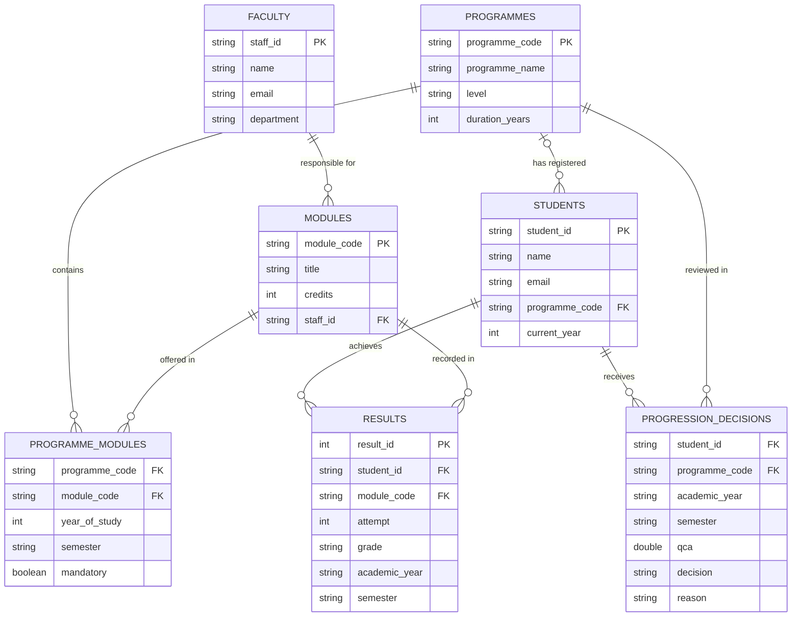

# Student Records System - Design

CS4013 Software Development Project (AY 2026/27). Design document for the UL Student Records System.

**Contents**

1. Overview and assumptions
2. Architecture and layer rules
3. Full class diagram
4. CSV schema
5. Main flows
6. CRC card outline

---

## 1. Overview and assumptions

### 1.1 What the system does

A Java command-line application that stores students, programmes, modules and results in CSV files. It calculates QCA per semester and overall, generates transcripts, and runs exam boards that decide each student's progression, using a representative subset of the rules in Chapters 2 and 3 of the UL Handbook of Academic Regulations 2026/27.

Core features (from the specification):

- Add student(s), add programme, add module
- Register student on programme
- Record module results
- Calculate semester QCA and overall QCA
- Generate transcript
- Identify progression status (through exam boards)

Users (CLI roles):

| Role | What the CLI lets them do |
|---|---|
| Student | View their own transcript |
| Faculty | Submit results for modules, look up transcripts |
| Department | Add students, programmes and modules, register students on programmes, hold exam boards |

### 1.2 Scope and assumptions

| # | Assumption |
|---|---|
| A1 | **Awards classification is out of scope.** `awards.csv` is not used by the system. |
| A2 | **Link-in modules are out of scope.** |
| A3 | **Compensation rules are in scope** and are implemented inside the progression rules. |
| A4 | Progression rules live in the **service layer** (`ProgressionRule` implementations), not in the model. |
| A5 | A module can belong to **many programmes**, and can be shared by undergraduate and postgraduate programmes. The year and semester of a module are properties of the module *in a programme* (`ProgrammeModule`), not of the module itself. |
| A6 | A student is registered on **one programme at a time**. The student's programme and current year are stored on `Student` (there is no `Registration` class). |
| A7 | A **review period is one semester** (`AcademicPeriod` = academic year + semester). A student's stage ("Year 3") is separate from calendar time ("Spring 2026/27"). |
| A8 | Programme levels modelled: `UNDERGRADUATE` and `POSTGRADUATE_TAUGHT`. Research programmes are not modelled. *(Proposed - team to confirm.)* |
| A9 | An exam board first **proposes** decisions (`holdBoard`) and the department then **confirms** them (`confirmBoard`). Confirming saves the decisions, and a `PROGRESS` decision moves the student to the next year. *(Proposed - team to confirm when the year advances, e.g. only after the Spring board.)* |
| A10 | Faculty is a **role in the CLI**. The `Faculty` class is small and only records who is responsible for a module. |
| A11 | CSV files are loaded fully into memory at startup and saved after each change. They are not a database, so **services validate** unique IDs and references between files. |

### 1.3 Rules to take from the Handbook (not yet decided)

These values and behaviours must be copied from the Handbook (Chapters 2-3), not guessed:

| Item | Where it is used |
|---|---|
| Quality point values (`qpv`) for A1 ... N | `Grade` enum |
| How `NG`, `P` and `N` behave (counted in QCA or not, pass or fail) | `Grade`, `QCACalculator` |
| Minimum QCA / pass conditions for progression (undergraduate and postgraduate) | `UndergraduateProgressionRule`, `PostgraduateProgressionRule` |
| Compensation conditions | Progression rules |
| Which attempt counts for a repeated module | `QCACalculator`, `ProgressionService` |
| Conditions for repeat module / semester / year | Progression rules |

### 1.4 Open points for the team

1. `results.csv` has a `result_id`, but `Result` in the class diagram has no `resultId` field. Either add the field, or generate the row ID when saving.
2. `ResultService.recordResult(...)` takes no staff ID, so "faculty can submit results only for their own modules" is **not enforced** yet. Either add a `staffId` parameter and check it against `Module.faculty`, or accept the simplification and document it.
3. `Person` has an `email`, but the current CSV files have no email column. Add `email` to `students.csv` and `faculty.csv`, or leave it empty.

---

## 2. Architecture and layer rules

### 2.1 Layers

Five packages under `src/main/java`:

| Package | Contains | Responsibility |
|---|---|---|
| `app` | `Main` | Entry point. Creates the repositories, services and CLI and connects them. No logic. |
| `presentation` | `Presentable`, `CLIUserInterface`, `Role` | Menus, input and output. Calls services only. |
| `service` | Services, `QCACalculator`, `ProgressionRule` and its implementations | All business rules and validation. |
| `repository` | `Repository`, `CsvRepository` and the CSV subclasses | Reads and writes the CSV files in `data/`. |
| `model` | Domain classes and enums | Plain data and simple behaviour. Depends on nothing. |

Dependency direction:

```text
app  ->  presentation  ->  service  ->  repository  ->  model
                              |                            ^
                              +----------------------------+
```

### 2.2 Layer rules

1. Dependencies only point downward. The model never depends on another layer.
2. The presentation layer calls **services only**. It never touches a repository or a CSV file.
3. Services hold the business rules (QCA, progression, compensation) and the validation (unique IDs, valid references). They use repositories through the `Repository` interface.
4. Repositories only convert between CSV rows and model objects. They contain no business rules.
5. `Main` is the only place that creates the objects and connects the layers.
6. Each Java class is in its own file (specification requirement).

### 2.3 Object-oriented principles demonstrated

| Principle | Where |
|---|---|
| Encapsulation | Private fields with getters in the model; the CSV format is hidden inside the repositories |
| Inheritance | `Person` -> `Student`, `Faculty`; `CsvRepository` -> one subclass per CSV file |
| Polymorphism | `ProgressionRule` (undergraduate and postgraduate behave differently behind one interface); `fromRow` / `toRow` in each CSV repository |
| Abstraction | `Person` and `CsvRepository` (abstract classes); `ProgressionRule`, `Repository` and `Presentable` (interfaces) |

---

## 3. Full class diagram

If your Mermaid renderer does not support `namespace`, delete the `namespace x { ... }` wrappers and keep the class bodies.

```mermaid
classDiagram
    direction TB

    %% =============== APP ===============
    namespace app {
        class Main {
            +main(String[]) void
        }
    }

    %% =============== PRESENTATION ===============
    namespace presentation {
        class Presentable {
            <<interface>>
            +run() void
        }
        class CLIUserInterface
        class Role {
            <<enumeration>>
            STUDENT
            FACULTY
            DEPARTMENT
        }
    }

    %% =============== MODEL ===============
    namespace model {
        class Person {
            <<abstract>>
            -personId: String
            -name: String
            -email: String
        }
        class Student {
            -programme: Programme
            -currentYear: int
        }
        class Faculty {
            -department: String
        }
        class Programme {
            -programmeCode: String
            -name: String
            -durationYears: int
            -level: ProgrammeLevel
        }
        class Module {
            -moduleCode: String
            -title: String
            -credits: int
            -faculty: Faculty
        }
        class ProgrammeModule {
            -programme: Programme
            -module: Module
            -yearOfStudy: int
            -semester: Semester
            -mandatory: boolean
        }
        class Result {
            -student: Student
            -module: Module
            -grade: Grade
            -period: AcademicPeriod
            -attempt: int
        }
        class AcademicPeriod {
            -academicYear: String
            -semester: Semester
        }
        class ExamBoard {
            -programme: Programme
            -period: AcademicPeriod
            -decisions: List~ProgressionDecision~
            +addDecision(ProgressionDecision) void
            +getDecisions() List~ProgressionDecision~
        }
        class ProgressionDecision {
            -student: Student
            -qca: double
            -decision: Decision
            -reason: String
        }
        class Transcript {
            -student: Student
            -results: List~Result~
            -semesterQCA: double
            -overallQCA: double
        }
        class Semester {
            <<enumeration>>
            AUTUMN
            SPRING
        }
        class ProgrammeLevel {
            <<enumeration>>
            UNDERGRADUATE
            POSTGRADUATE_TAUGHT
        }
        class Decision {
            <<enumeration>>
            PROGRESS
            COMPENSATED_PASS
            REPEAT_MODULE
            REPEAT_SEMESTER
            REPEAT_YEAR
        }
        class Grade {
            <<enumeration>>
            A1
            A2
            B1
            B2
            B3
            C1
            C2
            C3
            D1
            F
            NG
            P
            N
            -double qpv
            +getQpv() double
        }
    }

    %% =============== SERVICE ===============
    namespace service {
        class StudentService {
            +addStudent(Student) void
            +registerOnProgramme(String, String) void
            +findStudent(String) Student
            +getStudentsByProgramme(String) List~Student~
        }
        class ProgrammeService {
            +addProgramme(Programme) void
            +addModule(Module) void
            +addModuleToProgramme(String, String, int, Semester) void
        }
        class ResultService {
            +recordResult(String, String, Grade, AcademicPeriod) void
            +getResults(String) List~Result~
        }
        class QCACalculator {
            +calculateSemesterQCA(List~Result~) double
            +calculateOverallQCA(List~Result~) double
        }
        class TranscriptService {
            +generateTranscript(String) Transcript
        }
        class ProgressionService {
            +decide(Student, AcademicPeriod) ProgressionDecision
        }
        class ExamBoardService {
            +holdBoard(String, AcademicPeriod) ExamBoard
            +confirmBoard(ExamBoard) void
        }
        class ProgressionRule {
            <<interface>>
            +decide(Student, AcademicPeriod, List~Result~, double) ProgressionDecision
        }
        class UndergraduateProgressionRule
        class PostgraduateProgressionRule
    }

    %% =============== REPOSITORY ===============
    namespace repository {
        class Repository~T~ {
            <<interface>>
            +findAll() List~T~
            +saveAll(List~T~) void
        }
        class CsvRepository~T~ {
            <<abstract>>
            -filePath: String
            +findAll() List~T~
            +saveAll(List~T~) void
            #fromRow(String[]) T
            #toRow(T) String[]
        }
        class StudentCsvRepository
        class ProgrammeCsvRepository
        class ModuleCsvRepository
        class ProgrammeModuleCsvRepository
        class ResultCsvRepository
        class FacultyCsvRepository
        class ProgressionDecisionCsvRepository
    }

    %% ---------- app ----------
    Main ..> CLIUserInterface : creates and wires everything

    %% ---------- presentation ----------
    Presentable <|.. CLIUserInterface
    CLIUserInterface --> Role
    CLIUserInterface --> StudentService
    CLIUserInterface --> ProgrammeService
    CLIUserInterface --> ResultService
    CLIUserInterface --> TranscriptService
    CLIUserInterface --> ExamBoardService

    %% ---------- model ----------
    Person <|-- Student
    Person <|-- Faculty
    Student "0..*" --> "0..1" Programme : registered on
    Programme --> ProgrammeLevel
    Module "0..*" --> "1" Faculty : responsible
    ProgrammeModule "0..*" --> "1" Programme
    ProgrammeModule "0..*" --> "1" Module
    ProgrammeModule --> Semester
    Result "0..*" --> "1" Student
    Result "0..*" --> "1" Module
    Result --> Grade
    Result --> AcademicPeriod
    AcademicPeriod --> Semester
    ExamBoard "1" *-- "0..*" ProgressionDecision
    ExamBoard "0..*" --> "1" Programme
    ExamBoard --> AcademicPeriod
    ProgressionDecision "0..*" --> "1" Student
    ProgressionDecision --> Decision
    Transcript --> Student
    Transcript --> Result

    %% ---------- service ----------
    ProgressionRule <|.. UndergraduateProgressionRule
    ProgressionRule <|.. PostgraduateProgressionRule
    TranscriptService --> ResultService
    TranscriptService --> QCACalculator
    ProgressionService --> ResultService
    ProgressionService --> QCACalculator
    ProgressionService --> ProgressionRule : picks by programme level
    ExamBoardService --> ProgressionService
    ExamBoardService --> StudentService

    %% ---------- service uses model ----------
    StudentService ..> Student
    ProgrammeService ..> Programme
    ProgrammeService ..> Module
    ProgrammeService ..> ProgrammeModule
    ResultService ..> Result
    TranscriptService ..> Transcript
    ProgressionService ..> ProgressionDecision
    ExamBoardService ..> ExamBoard

    %% ---------- repository ----------
    Repository <|.. CsvRepository
    CsvRepository <|-- StudentCsvRepository
    CsvRepository <|-- ProgrammeCsvRepository
    CsvRepository <|-- ModuleCsvRepository
    CsvRepository <|-- ProgrammeModuleCsvRepository
    CsvRepository <|-- ResultCsvRepository
    CsvRepository <|-- FacultyCsvRepository
    CsvRepository <|-- ProgressionDecisionCsvRepository

    %% ---------- services use repositories ----------
    StudentService ..> Repository
    ProgrammeService ..> Repository
    ResultService ..> Repository
    ExamBoardService ..> Repository

    %% ---------- repositories use model ----------
    StudentCsvRepository ..> Student
    ProgrammeCsvRepository ..> Programme
    ModuleCsvRepository ..> Module
    ProgrammeModuleCsvRepository ..> ProgrammeModule
    ResultCsvRepository ..> Result
    FacultyCsvRepository ..> Faculty
    ProgressionDecisionCsvRepository ..> ProgressionDecision
```



### Notes on the diagram

- `Programme` is not subclassed by level. The level is a property (`ProgrammeLevel`), because modules are shared between undergraduate and postgraduate programmes. The behaviour that differs by level is in the `ProgressionRule` implementations.
- `Result` references both `Student` and `Module`. `Student` does not keep a list of results; `ResultService.getResults(studentId)` finds them.
- `ExamBoard` owns its `ProgressionDecision` objects (composition). Each decision stores the student, QCA, decision and reason; the period comes from the board.
- `ProgressionService` chooses the rule from the programme's `ProgrammeLevel`.
- `CsvRepository<T>` reads and writes the file once. Each subclass only says how one row becomes an object (`fromRow`) and back (`toRow`).

---

## 4. CSV schema

All files are in `data/`. Enum values are stored as text (for example `A1`, `SPRING`, `UNDERGRADUATE`). Headers below are the proposed final versions, corrected from the current files so they match the design.

| File | Columns | Notes |
|---|---|---|
| `programmes.csv` | `programme_code`, `programme_name`, `level`, `duration_years` | `level` is `UNDERGRADUATE` or `POSTGRADUATE_TAUGHT`. `duration_years` is new. |
| `students.csv` | `student_id`, `name`, `email`, `programme_code`, `current_year` | `programme_code` and `current_year` are empty until the student is registered. `email` and `current_year` are new. |
| `faculty.csv` | `staff_id`, `name`, `email`, `department` | New file. |
| `modules.csv` | `module_code`, `title`, `credits`, `staff_id` | `programme_code` and `semester` are **removed** (a module can be in many programmes). `title` and `staff_id` are new. |
| `programme_modules.csv` | `programme_code`, `module_code`, `year_of_study`, `semester`, `mandatory` | New file. Links modules to programmes. `semester` is `AUTUMN` or `SPRING`. |
| `results.csv` | `result_id`, `student_id`, `module_code`, `attempt`, `grade`, `academic_year`, `semester` | `academic_year` (for example `2026/27`) and `semester` are new. `attempt` starts at 1 and increases for repeats. |
| `progression_decisions.csv` | `student_id`, `programme_code`, `academic_year`, `semester`, `qca`, `decision`, `reason` | Saved when an exam board is confirmed. `decision` is one of the `Decision` values. |
| `awards.csv` | - | Not used (awards are out of scope). |

### Entity relationships



### Validation done by the services

- IDs are unique: `student_id`, `staff_id`, `programme_code`, `module_code`, `result_id`.
- References exist: a student's `programme_code`, a module's `staff_id`, a result's `student_id` and `module_code`, both codes in `programme_modules.csv`.
- `grade` is a valid `Grade`; `semester` is a valid `Semester`; `level` is a valid `ProgrammeLevel`.
- A programme-module pair appears only once.

---

## 5. Main flows

### 5.1 Record a result (Faculty)

```mermaid
sequenceDiagram
    actor F as Faculty
    participant CLI as CLIUserInterface
    participant RS as ResultService
    participant R as Repositories

    F->>CLI: choose "Submit result"
    CLI->>RS: recordResult(studentId, moduleCode, grade, period)
    RS->>R: findAll() students, modules, results
    RS->>RS: check student and module exist; attempt = previous attempts + 1
    RS->>R: saveAll(results)
    RS-->>CLI: done (or validation error)
    CLI-->>F: confirmation
```

### 5.2 Hold an exam board (Department)

```mermaid
sequenceDiagram
    actor D as Department
    participant CLI as CLIUserInterface
    participant EBS as ExamBoardService
    participant SS as StudentService
    participant PS as ProgressionService
    participant RS as ResultService
    participant Q as QCACalculator
    participant Rule as ProgressionRule

    D->>CLI: hold exam board (programme, period)
    CLI->>EBS: holdBoard(programmeCode, period)
    EBS->>SS: getStudentsByProgramme(programmeCode)
    SS-->>EBS: students
    loop each student
        EBS->>PS: decide(student, period)
        PS->>RS: getResults(studentId)
        RS-->>PS: results
        PS->>Q: calculateSemesterQCA(results of the period)
        Q-->>PS: qca
        PS->>PS: pick rule from programme level
        PS->>Rule: decide(student, period, results, qca)
        Rule-->>PS: ProgressionDecision
        PS-->>EBS: ProgressionDecision
    end
    EBS-->>CLI: ExamBoard (proposed decisions)
    CLI-->>D: show decisions table
    D->>CLI: confirm
    CLI->>EBS: confirmBoard(board)
    EBS->>EBS: save decisions; PROGRESS moves student to next year
```

### 5.3 View a transcript (Student or Faculty)

1. The user enters a student ID (a student can only view their own).
2. `CLIUserInterface` calls `TranscriptService.generateTranscript(studentId)`.
3. `TranscriptService` gets the results from `ResultService`, and the semester and overall QCA from `QCACalculator`.
4. It returns a `Transcript`, and the CLI prints it.

### 5.4 Register a student on a programme (Department)

1. The user enters a student ID and a programme code.
2. `CLIUserInterface` calls `StudentService.registerOnProgramme(studentId, programmeCode)`.
3. The service checks that both exist, sets the student's programme, sets `currentYear` to 1 and saves.

### 5.5 Other flows

- **Add student:** `StudentService.addStudent` checks the ID is unique and saves.
- **Add programme / add module:** `ProgrammeService` checks the code is unique (and the responsible faculty exists for a module) and saves.
- **Add module to programme:** `ProgrammeService.addModuleToProgramme(programmeCode, moduleCode, year, semester)` creates a `ProgrammeModule`.

---

## 6. CRC card outline

Use these to build the Word document (one card per class). Collaborators are the classes it works with.

### 6.1 Presentation

| Class | Responsibilities | Collaborators |
|---|---|---|
| `Presentable` (interface) | Defines how a user interface is started (`run`) | `CLIUserInterface` |
| `CLIUserInterface` | Shows menus per role; reads input; prints results; calls services | `Role`, `StudentService`, `ProgrammeService`, `ResultService`, `TranscriptService`, `ExamBoardService` |
| `Role` (enum) | Names the user roles: Student, Faculty, Department | `CLIUserInterface` |

### 6.2 App

| Class | Responsibilities | Collaborators |
|---|---|---|
| `Main` | Starts the application; creates and connects repositories, services and the CLI | `CLIUserInterface`, services, repositories |

### 6.3 Service

| Class | Responsibilities | Collaborators |
|---|---|---|
| `StudentService` | Add student; register on programme; find student; list students of a programme; validate IDs and references | `Student`, `Programme`, `Repository` |
| `ProgrammeService` | Add programme; add module; link a module to a programme (year, semester); validate codes | `Programme`, `Module`, `ProgrammeModule`, `Repository` |
| `ResultService` | Record a result (set attempt number); get a student's results; validate student, module and grade | `Result`, `Student`, `Module`, `Grade`, `Repository` |
| `QCACalculator` | Calculate semester QCA and overall QCA from results (grade points weighted by credits) | `Result`, `Grade`, `Module` |
| `TranscriptService` | Build a transcript for a student | `ResultService`, `QCACalculator`, `Transcript` |
| `ProgressionService` | Gather a student's results for a period, calculate QCA, pick the rule for the programme level, return the decision | `ResultService`, `QCACalculator`, `ProgressionRule`, `ProgressionDecision` |
| `ExamBoardService` | Hold a board (propose a decision for each student of a programme); confirm a board (save decisions, advance students) | `StudentService`, `ProgressionService`, `ExamBoard`, `Repository` |
| `ProgressionRule` (interface) | Defines how a progression decision is made from a student's results and QCA | `ProgressionDecision`, `Student`, `Result` |
| `UndergraduateProgressionRule` | Applies undergraduate progression, repeat and compensation rules | `ProgressionDecision`, `Grade` |
| `PostgraduateProgressionRule` | Applies postgraduate taught progression, repeat and compensation rules | `ProgressionDecision`, `Grade` |

### 6.4 Repository

| Class | Responsibilities | Collaborators |
|---|---|---|
| `Repository<T>` (interface) | Defines `findAll` and `saveAll` | services |
| `CsvRepository<T>` (abstract) | Reads and writes a CSV file; leaves row conversion to subclasses | `Repository` |
| `StudentCsvRepository` | Converts student rows to `Student` and back | `Student`, `Programme` |
| `ProgrammeCsvRepository` | Converts programme rows to `Programme` and back | `Programme` |
| `ModuleCsvRepository` | Converts module rows to `Module` and back | `Module`, `Faculty` |
| `ProgrammeModuleCsvRepository` | Converts programme-module rows to `ProgrammeModule` and back | `ProgrammeModule`, `Programme`, `Module` |
| `ResultCsvRepository` | Converts result rows to `Result` and back | `Result`, `Student`, `Module` |
| `FacultyCsvRepository` | Converts faculty rows to `Faculty` and back | `Faculty` |
| `ProgressionDecisionCsvRepository` | Converts decision rows to `ProgressionDecision` and back | `ProgressionDecision`, `Student` |

### 6.5 Model

| Class | Responsibilities | Collaborators |
|---|---|---|
| `Person` (abstract) | Holds ID, name and email shared by students and faculty | `Student`, `Faculty` |
| `Student` | Holds the student's programme and current year | `Person`, `Programme` |
| `Faculty` | Holds the staff member's department | `Person`, `Module` |
| `Programme` | Holds code, name, duration and level | `ProgrammeLevel`, `ProgrammeModule` |
| `Module` | Holds code, title, credits and the responsible faculty member | `Faculty` |
| `ProgrammeModule` | Says in which year and semester a module is taught in a programme, and whether it is mandatory | `Programme`, `Module`, `Semester` |
| `Result` | Holds one grade for a student in a module for a period and attempt | `Student`, `Module`, `Grade`, `AcademicPeriod` |
| `AcademicPeriod` | Identifies a review period: academic year + semester | `Semester` |
| `ExamBoard` | Holds the programme, period and the list of decisions made | `Programme`, `AcademicPeriod`, `ProgressionDecision` |
| `ProgressionDecision` | Holds one student's decision, QCA and reason | `Student`, `Decision` |
| `Transcript` | Holds a student's results and QCA values for display | `Student`, `Result` |
| `Grade` (enum) | Lists the grades and gives the quality point value of each (`getQpv`) | `Result` |
| `Semester` (enum) | AUTUMN, SPRING | `AcademicPeriod`, `ProgrammeModule` |
| `ProgrammeLevel` (enum) | UNDERGRADUATE, POSTGRADUATE_TAUGHT | `Programme` |
| `Decision` (enum) | PROGRESS, COMPENSATED_PASS, REPEAT_MODULE, REPEAT_SEMESTER, REPEAT_YEAR | `ProgressionDecision` |
