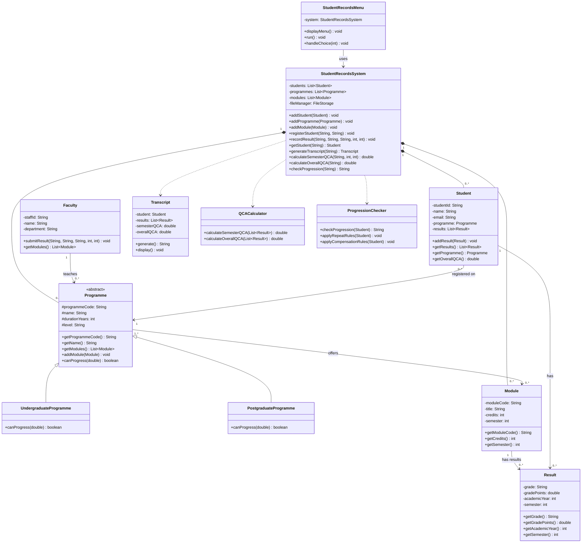

# Student Records System - UML Class Diagram

/**
There are few things I spotted about that diagram.
1. Sense one module can be shared by multiple programmes, so the relation of module and programme cannot be like this. -- Done
2. And also there are several modules are shared by postgraduate student and undergraduate student, like CS4416 DATABASE SYSTEMS. --
So I think this abstract class part should be adjust.
And there is also a problem at relation between faculty and student, the faculty not just directly teaching student, he/she response to module, and students are enrolled in a module.
And another problem confused me is the relationship between Module and Result, the Result should have fields type is Module, Student and the relationship should like:

Student "1" *-- "0..*" Result
Module  "1" *-- "0..*" Result
Result --> Student
Result --> Module
*/

Student and faculty may inherite from the class Person