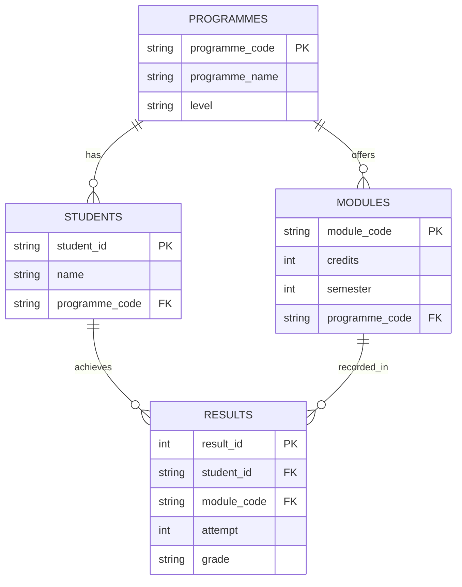

# CS4013-Student-Records-Project

## Project Structure

All Java source code lives in the Maven source tree (`src/main/java`). There is no
separate `Code/` directory, and all CSV data (including mock/test data) lives in
`data/` — there is no separate `CSV/` directory.

```text
.
├── pom.xml                     # Maven build (Java 17, JUnit 5, executable JAR)
├── mvnw / mvnw.cmd             # Maven Wrapper launchers (no local Maven needed)
├── .mvn/wrapper/               # Maven Wrapper configuration (pinned Maven 3.10.0)
├── README.md
├── AGENTS.md                   # Conventions and shared agent context (see below)
├── .gitattributes              # Line-ending normalisation
├── .editorconfig               # Editor defaults (indent, charset, EOL)
├── .gitignore
├── .github/
│   ├── agents/                 # Shared course materials: spec + UL handbook
│   └── workflows/              # GitHub Actions CI
├── CRC/                        # CRC cards (documentation deliverable)
├── data/                       # CSV data files, including mock/test data
└── src
    ├── main
    │   ├── java
    │   │   ├── app/            # Application entry point
    │   │   ├── model/          # Domain models and enums
    │   │   ├── presentation/   # Command-line interface and input
    │   │   ├── repository/     # Student data repositories
    │   │   └── service/        # QCA, award, and progression logic
    │   └── resources/          # Application resources
    └── test
        └── java
            ├── model/
            ├── presentation/
            ├── repository/
            └── service/
```

## Data Files

CSV files are stored in [`data/`](data/). The four populated files currently contain
sample records:

| File | Purpose | Current data |
| --- | --- | --- |
| [`programmes.csv`](data/programmes.csv) | Programme code, name, and level | 5 programmes |
| [`students.csv`](data/students.csv) | Student ID, name, and programme code | 60 students |
| [`modules.csv`](data/modules.csv) | Module code, credits, semester, and programme code | 20 modules |
| [`results.csv`](data/results.csv) | Individual result attempt, linked to a student and module | 60 results; all are attempt 1 |

`result_id` identifies a result row. The `attempt` column allows a student's
results for the same module to be recorded for multiple attempts, such as a
repeat. The CSV files are not a database, so the application must validate ID
uniqueness and references between files.

[`progression_decisions.csv`](data/progression_decisions.csv) and
[`awards.csv`](data/awards.csv) are placeholders only. Their data models and
contents have not yet been designed; the current headers are subject to change.

The ER diagram below describes the four populated CSV files. `result_id` is the
result row's identifier, and `student_id` and `module_code` link it to the
student and module. A student or module can have multiple result rows to allow
for repeated attempts.



## Shared agent context

[.github/agents/](.github/agents) holds the authoritative course materials shared by the
whole team:

- `CS4013 Software Development ProjectAY202627.md` / `.pdf` — the assignment specification
- `Handbook of Academic Regulations and Procedures 2026-27 Chapter 2-3.md` / `.pdf` — the
  UL marking and progression regulations the system must implement

The `.md` and `.pdf` copies of each document have the same content; prefer the `.md`.
If any requirement is unclear, consult these documents before deciding — see
[AGENTS.md](AGENTS.md) for the details.

## TODO

- [ ] Add an example JUnit 5 test under `src/test/java/model/` (e.g. `GradeTest`)
      that asserts something trivial about a `Grade`, so `mvn test` demonstrably
      executes at least one test instead of silently passing with zero tests.

## Build and Run

Requires JDK 17. Maven itself is optional: use the wrapper (`./mvnw`, or
`mvnw.cmd` on Windows) and it downloads the pinned Maven 3.10.0 on first run.

```bash
./mvnw test         # compile and run the unit tests
./mvnw package      # build the executable JAR (main class: app.Main)
java -jar target/student-records-1.0-SNAPSHOT.jar
```

Without the wrapper, the same commands work with a local `mvn`.
