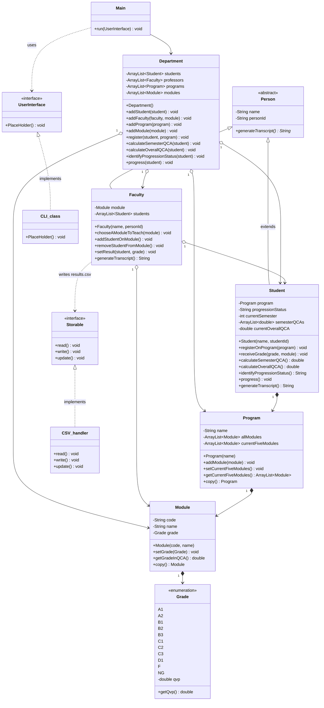

# CS4013 Student Record System – UML Class Diagram

## Container model

Each `Student` owns its own copy of a `Program`, which owns its own copies of the `Module` objects, each holding its own `Grade`:

`Student[Program[Module1[Grade], Module2[Grade], ...]]`

- `Department` stores the `Program` and `Module` objects as grade-free templates.
- `Department.register(student, program)` calls `program.copy()`, which calls `copy()` on each module (grades start as `NG`), and gives the copy to the student.
- `Faculty.setResult(student, grade)` finds the student's own copy of the module (matched by module `code`) and sets the grade there.

## Relationship summary

| From | Relationship | To | Multiplicity (at source) |
|---|---|---|---|
| Student | Inheritance (extends) | Person | – |
| Faculty | Inheritance (extends) | Person | – |
| CLI_class | Realization (implements) | UserInterface | – |
| CSV_handler | Realization (implements) | Storable | – |
| Main | Association (uses) | Department | – |
| Main | Dependency (uses) | CLI_class | – |
| Faculty | Dependency (uses) | Storable | – |
| Department | Aggregation | Faculty | 1 |
| Department | Aggregation | Student | 1 |
| Department | Aggregation | Program | 1 |
| Department | Aggregation | Module | 1 |
| Faculty | Aggregation | Module | 1 |
| Faculty | Aggregation | Student | 1 |
| Student | Composition | Program | 1 |
| Program | Composition | Module | 1 |
| Module | Composition | Grade | 1 |